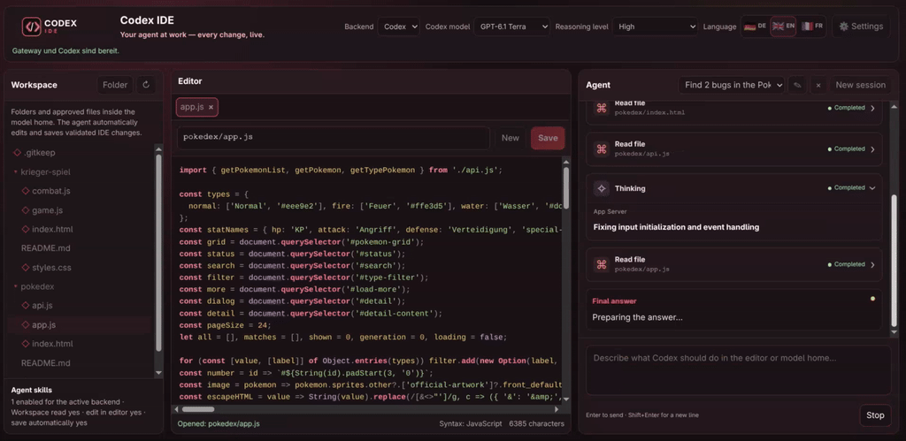

# Codex IDE

**Your agent at work. Every change, live.**

[](https://github.com/Mcpasi/codex-ide/releases)
[](https://nodejs.org/)
[](LICENSE)



Codex IDE brings your coding agent, editor and project files together in one browser-based workspace. Watch the agent open files, write code and check its work while you follow the conversation in real time.

[Watch the demo](https://youtu.be/o9aAy9NVCOA?is=0xDMwUE6E3fh8jmN) · [Download a release](https://github.com/Mcpasi/codex-ide/releases) · [Technical documentation](DOKUMENTATION_EN.md)

## What you can do

- **Watch your agent work:** See edits appear character by character in the editor, with additions and deletions highlighted. Follow work notes and expandable tool and verification cards in the conversation.
- **Work across your project:** Browse files and folders, keep multiple tabs open, and let your agent make coordinated changes across files. Files being edited open automatically in the editor.
- **Choose your backend:** Use the Codex CLI, Antigravity CLI, an OpenAI-compatible API, or a local browser model.
- **Run and preview:** Preview saved HTML files in an isolated browser view and follow tests, checks and builds in the live console.
- **Pick up where you left off:** Save, rename, switch between and resume named agent sessions with their conversation history.
- **Make it yours:** Install skills, choose German, English or French, and install the interface as a PWA.

## Requirements

- **Node.js 18.18.0 or newer**, with npm.
- A modern browser.
- For the **Codex** backend: the [official Codex CLI](https://github.com/openai/codex#readme), available as `codex` in your terminal, and a Codex sign-in. The API and local backends do not require the CLI.
- For **Antigravity**: the [official Antigravity CLI](https://antigravity.google/docs/cli/headless/), available as `agy`, with an existing sign-in or `codex-ide antigravity login`. Set `ANTIGRAVITY_BIN` if the executable is not on your PATH.

The separate user console is available on Linux and requires a C compiler such as `cc`, `gcc` or `clang`.

## Installation

1. Download the `codex-ide-1.3.3.tgz` release asset from [GitHub Releases](https://github.com/Mcpasi/codex-ide/releases).
2. Open a terminal in the directory containing the downloaded file and install it:

   ```bash
   npm install -g ./codex-ide-1.3.3.tgz
   ```

   For another release, use the filename of the `.tgz` asset you downloaded. There is no need to extract it first. If your system requires administrator permissions for global packages, use `sudo npm install -g ./codex-ide-1.3.3.tgz` on Linux or macOS.

3. Start Codex IDE:

   ```bash
   codex-ide start
   ```

The IDE opens in your browser at [http://localhost:8787/](http://localhost:8787/). If the browser does not open automatically, visit that address yourself. Keep the terminal running while you use the IDE; press `Ctrl+C` there to stop it.

## Get started

1. Start Codex IDE and open the workspace in your browser.
2. Select a backend in the header or in **Settings**.
3. For Codex, sign in with `codex-ide codex login`. You can also use device authentication with `codex-ide codex login --device-auth`. Check your sign-in with `codex-ide codex status`.
4. Add or open files in your workspace, then tell your agent what you want to work on.

Send a message with **Enter** and add a new line with **Shift+Enter**. Switch languages with the flag buttons in the header.

## Choose a backend

| Backend | How it works |
| --- | --- |
| **Codex** | Connects to the local Codex CLI and its App Server. Supports streamed activity, the available model and reasoning catalog, and usage information reported by Codex. |
| **Antigravity CLI** | Reuses your official CLI sign-in and a persistent streaming process per session. Uses the same visible editor, automatic saves, recovery and verification console as Codex. |
| **API** | Connects to an OpenAI-compatible endpoint, for example OpenAI, OpenRouter, Ollama or LM Studio. |
| **Local** | Runs a Transformers.js text model in the browser. |

In **Settings → Codex auth bridge**, you can check sign-in and usage, or test the gateway with a short Codex request. Available reasoning levels depend on the selected model.

Select **Antigravity CLI** in the header or settings to use the new backend. Its gateway URL, model, reasoning and conversation IDs are stored separately from Codex. **Settings → Antigravity CLI** provides sign-in commands, a status check and a real connection test. Authentication stays inside the official CLI.

## Your workspace

Your files live in `model-home`. The gateway prints the active path when it starts. For a global installation, the default locations are:

| System running the gateway | Workspace |
| --- | --- |
| Linux | `$XDG_DATA_HOME/codex-ide/model-home`, or `~/.local/share/codex-ide/model-home` |
| Android with Termux | `$HOME/.local/share/codex-ide/model-home`, unless an absolute `XDG_DATA_HOME` is set |
| macOS | `~/Library/Application Support/codex-ide/model-home` |
| Windows | `%LOCALAPPDATA%/codex-ide/model-home` |

On Windows, the gateway falls back to an absolute `%APPDATA%` or `<user home>/AppData/Local` if needed. A source checkout uses its own `model-home` directory. You can set a custom path with `CODEX_IDE_MODEL_HOME`.

## Update from a release

Download the new `.tgz` asset and install it with the same command, using the new filename. Your globally installed workspace is stored separately from the package and remains in place. Check the installed version with:

```bash
codex-ide version
```

To start without the built-in update check, use `codex-ide start --no-update-check`.

## Skills

Open **Settings → Skills** to manage built-in and installed skills for each backend. External skill entrypoints run JavaScript inside the app and require your explicit trust confirmation. You can also validate and package local skills:

```bash
codex-ide skill validate skill_packages/PDF_Skill
codex-ide skill pack skill_packages/PDF_Skill
```

See the [skill development guide](SKILL_DEVELOPMENT_EN.md) for details.

## Useful commands

| Command | Purpose |
| --- | --- |
| `codex-ide start` | Start the gateway and open the IDE. |
| `codex-ide start --no-open` | Start without opening a browser. |
| `codex-ide codex login` | Sign in to Codex. |
| `codex-ide codex login --device-auth` | Sign in using device authentication. |
| `codex-ide codex status` | Check Codex sign-in status. |
| `codex-ide antigravity login` | Sign in through the official `agy acp --login` flow. |
| `codex-ide antigravity status` | Check Antigravity sign-in without generating a model answer. |
| `codex-ide version` | Show the installed version. |
| `codex-ide clean` | Clear the app cache and service worker while keeping settings and skill state. |

Type `/console start` in the IDE to open the separate user console and `/console close` to leave it. Console commands operate in your real workspace and are not sent to the model. On Linux, the console uses a protected runner; see the [technical documentation](DOKUMENTATION_EN.md) for its restrictions.

## How the workspace is protected

The gateway listens on loopback by default. Codex and Antigravity inspect the workspace and make changes through the visible editor. Edits are saved after they have appeared in the editor. Verification commands run against a disposable workspace copy, so their generated files do not replace your project files. The separate user console works on the real workspace and is controlled by you.

For details about the editor, command sandbox, workspace access and browser preview, see the [technical documentation](DOKUMENTATION_EN.md).

## Development and tests

From a source checkout:

```bash
npm ci
./codex-ide start
```

Run the test suite with `npm test`, check the PWA with `npm run pwa:validate`, or run the performance suite with `npm run test:performance`. See the [test guide](test/README.md) and [performance methodology](test/PERFORMANCE.md).

## License

[MIT](LICENSE)
